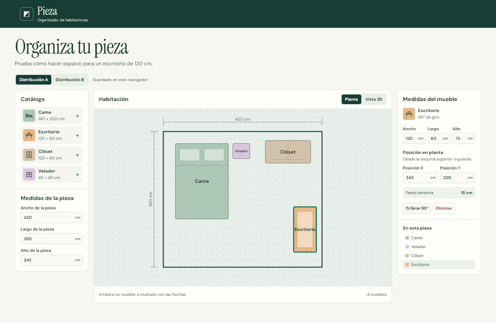
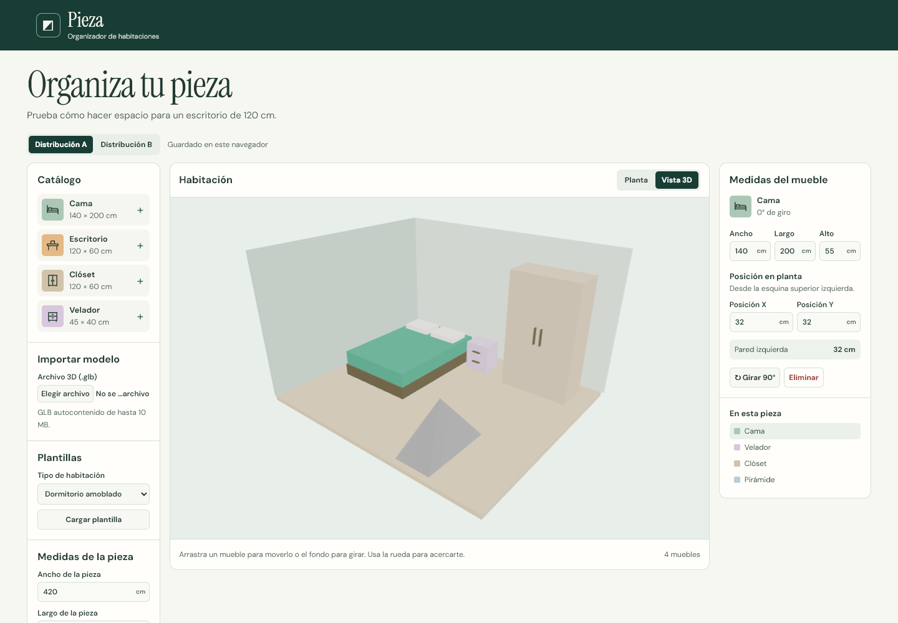

# Pieza

Organizador de habitaciones para probar distribuciones antes de mover los muebles. [Abrir la demo](https://humiumii.github.io/organizador-habitaciones-3d/).



## Ejecutar

Requiere Node.js 24 y npm.

```sh
npm ci
npm run dev
npm test
npm run build
npm run preview
```

El build genera `dist/`. Se puede servir desde un directorio de un sitio estático. GitHub Actions ejecuta las pruebas y publica ese directorio en GitHub Pages al integrar cambios en `main`.

## Probar el ejemplo

1. Agrega un **Escritorio** de 120 × 60 cm. La posición inicial se cruza con la cama.
2. Gíralo 90° y ubícalo en X = 345, Y = 200 cm. Queda a 15 cm de la pared derecha.
3. Alterna a **Vista 3D**. Arrastra el escritorio para moverlo sobre el suelo, o arrastra el fondo para girar la cámara. Usa la rueda para acercarte.
4. Pasa a **Distribución B** y prueba otra ubicación. Cada distribución conserva sus muebles y medidas mediante guardado automático en el navegador.

## Plantillas y modelos propios

- En **Plantillas**, elige dormitorio amoblado, oficina en casa, dormitorio compacto o habitación vacía. Confirma para reemplazar la distribución activa.
- En **Importar modelo**, elige un GLB 2.0 autocontenido de hasta 10 MB. Exporta con las texturas incluidas y sin compresión que requiera decodificadores. Los formatos OBJ y FBX requieren conversión a GLB.
- El tamaño inicial se obtiene de la caja del modelo en metros y se convierte a centímetros. Puedes moverlo, girarlo y ajustar sus medidas como cualquier otro mueble. Las alertas usan su huella rectangular.
- Los archivos permanecen en IndexedDB y se recuperan al recargar en el mismo navegador.



## Geometría

El modelo compartido usa centímetros enteros. El origen de planta está en la esquina superior izquierda. X crece hacia la derecha e Y hacia abajo. La posición ancla la esquina superior izquierda de la huella. Al girar 90° o 270°, la huella intercambia ancho y largo y conserva el ancla. Las dimensiones editables corresponden a los ejes propios del mueble.

Dos huellas rectangulares se superponen si sus intervalos comparten longitud positiva en los dos ejes. Un contacto exacto por borde o esquina tiene área cero. La distancia a la pared más cercana es la menor de las cuatro holguras entre la huella y los límites de la pieza. Una holgura negativa indica una salida del perímetro y cero indica contacto válido.

El plano SVG y React Three Fiber comparten el modelo. En 3D, X de planta pasa a X e Y de planta a Z. Cada mueble se dibuja centrado sobre su huella con su giro y la altura va sobre el eje vertical. Dos paredes quedan abiertas para facilitar la vista interior.

Las distribuciones se guardan mediante `localStorage` por navegador y origen. Ambas parten de copias independientes de la pieza de ejemplo.
